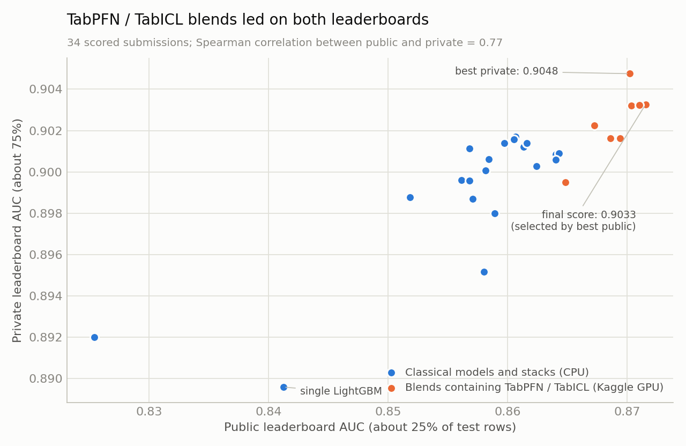
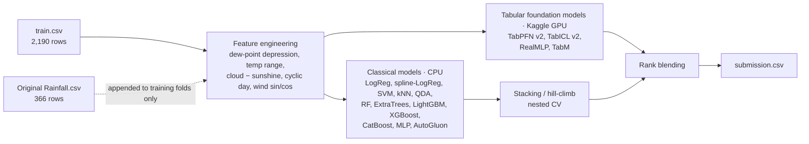

<div align="center">

# 🌧️ Rainfall Probability Prediction Challenge

**5th place of 79 teams on the private leaderboard · ROC AUC 0.9033**

[](https://www.kaggle.com/competitions/rainfall-probability-prediction-challenge)


[](LICENSE)

</div>

Code, experiments and results for the Kaggle community competition
[Rainfall Probability Prediction Challenge](https://www.kaggle.com/competitions/rainfall-probability-prediction-challenge)
(a re-run of Playground Series S5E3): predict the probability of rain for each day from ten daily weather measurements,
scored by ROC AUC.

## Contents

- [Result](#result)
- [The problem](#the-problem)
- [Approach](#approach)
- [Model scores](#model-scores)
- [What I learned](#what-i-learned)
- [Repository layout](#repository-layout)
- [Reproduce](#reproduce)
- [Kaggle notebooks](#kaggle-notebooks)

## Result

| | Public LB (~25%) | Private LB (~75%) |
|---|---|---|
| **Final scored submission** — `1.5 × TabICL − 0.5 × classical stack` (rank blend) | 0.8715 (8th) | **0.9033 (5th of 79)** |
| Best private score among my submissions — `1.5 × TabICL − 0.5 × logistic regression` | 0.8702 | 0.9048 |
| TabICL v2 alone | 0.8710 | 0.9032 |
| TabPFN v2 alone | 0.8686 | 0.9016 |
| Classical 13-model stack (best cross-validated entry) | 0.8624 | 0.9003 |
| Single LightGBM | 0.8412 | 0.8896 |

The winning team scored 0.9092. All 35 of my scored submissions are in
[`results/submissions.csv`](results/submissions.csv).



## The problem

- **Data:** 2,190 training days (six synthetic "years") and 730 test days, with pressure, three temperatures, dew point,
  humidity, cloud cover, sunshine hours, wind direction and wind speed. 75% of training days are rainy.
- **Extra data:** the original 366-row [Rainfall dataset](https://www.kaggle.com/datasets/subho117/rainfall-prediction-using-machine-learning)
  the synthetic data was generated from.
- **Why it is hard:** the dataset is tiny and the signal saturates early. A plain logistic regression on the raw columns
  already reaches 0.894 cross-validated AUC, and nothing I built got past 0.897.

## Approach



1. **Validation first.** Every model is scored with 5-fold × 3-repeat stratified CV *and* leave-one-year-out CV
   (the test set is two unseen years). Blend weights are checked with nested CV so they are never scored on rows they were fit on.
2. **Classical stack** ([`src/pretrain_finetune_stack.py`](src/pretrain_finetune_stack.py)): 13 model families, optional
   pre-training on the original dataset followed by fine-tuning, and eight blending strategies compared under nested CV.
3. **Independent seed-averaged ensemble** ([`src/build_ensemble.py`](src/build_ensemble.py)): 12 small, heavily regularised
   models used as a second opinion on the stack.
4. **Tabular foundation models on Kaggle GPUs** ([`kaggle_gpu/`](kaggle_gpu)): TabPFN v2 and TabICL v2 run in private
   Kaggle kernels on the same CV splits, so their out-of-fold predictions can be blended offline.
5. **Rank blending** ([`src/blend_candidates.py`](src/blend_candidates.py), [`src/blend_weighted.py`](src/blend_weighted.py)).

## Model scores

Cross-validated ROC AUC on the training set (5×3 repeated stratified CV; LOYO = leave-one-year-out).

| Model | Features | Original data | Repeated CV | LOYO |
|---|---|:-:|---|---|
| Classical stack (stack_LR, nested CV) | engineered | ✓ | **0.8959** | 0.8957 |
| Logistic regression | engineered | ✓ | 0.8939 | 0.8946 |
| LightGBM (4 leaves) | engineered | ✓ | 0.8938 | 0.8949 |
| TabPFN v2 (16 estimators) | raw | ✓ | 0.8938 | **0.8956** |
| Logistic regression | raw | | 0.8937 | 0.8947 |
| TabICL v2 (32 estimators) | raw | ✓ | 0.8934 | 0.8948 |
| TabM † | engineered | ✓ | 0.8916 | — |
| XGBoost (depth 2) | engineered | | 0.8909 | 0.8926 |
| ExtraTrees | engineered | | 0.8907 | 0.8927 |
| SVM (RBF) | engineered | | 0.8902 | 0.8913 |
| CatBoost (depth 3) | engineered | | 0.8896 | 0.8914 |
| RealMLP † | engineered | ✓ | 0.8891 | — |

† AUC of the repeat-averaged out-of-fold prediction, which runs slightly higher than the per-repeat mean used in the other rows.

## What I learned

- **Cross-validation could not separate the top models, but the leaderboard did.** TabICL and TabPFN cross-validate
  0.002 *below* the classical stack, yet scored higher on the private leaderboard (TabICL +0.003, TabPFN +0.001). With 2,190 rows the CV
  noise is larger than the differences that decided the ranking.
- **The public leaderboard was more informative than I assumed.** It is only ~180 rows and I treated differences on it
  as noise, but across my submissions public and private scores have a Spearman correlation of 0.77.
- **Original data helps a little, consistently.** Appending the 366 original rows to the training folds added
  +0.0015 to +0.002 AUC for LightGBM, TabPFN and TabICL.
- **Neighbouring-day features do not help.** The rows are in calendar order and pressure/dew point are strongly
  autocorrelated, but lag, lead and rolling features lowered AUC for both linear and tree models
  ([`src/exp_neighbour_features.py`](src/exp_neighbour_features.py)).
- **Subtracting a weaker model can beat averaging with it.** On the private leaderboard `1.5 × TabICL − 0.5 × stack` beat the 50/50 blend
  (0.9033 vs 0.9022) and matched TabICL alone, and `1.5 × TabICL − 0.5 × logistic regression` was my best entry
  (0.9048 vs 0.8995 for the 50/50 blend), despite *lower* CV scores (0.891). This was tuned on the public leaderboard, so
  treat it as an observation rather than a recipe.
- **Deep tabular nets with default settings were not competitive** here (RealMLP, TabM: 0.884–0.892).

## Repository layout

```
├── src/
│   ├── pretrain_finetune_stack.py   # 13-model stack with pretrain → fine-tune and nested-CV blending
│   ├── build_ensemble.py            # independent 12-model seed-averaged ensemble
│   ├── exp_neighbour_features.py    # lag / lead / rolling feature experiment
│   ├── tabpfn_cpu_cv.py             # TabPFN baseline on CPU
│   ├── blend_hillclimb.py           # greedy hill-climb blend with nested check
│   ├── blend_candidates.py          # named rank-blend candidates
│   ├── blend_weighted.py            # weighted (incl. negative-weight) rank blends
│   └── plot_public_vs_private.py    # chart above
├── kaggle_gpu/
│   ├── kernel_template.py           # GPU kernel: TabPFN / TabICL / RealMLP / TabM
│   ├── build.py                     # builds one kernel folder per model family
│   └── showlog.py                   # prints a downloaded kernel log
├── notebooks/                       # notebook version of the stack
├── outputs/
│   ├── stack_run1..3/               # submissions and logs from three stack runs
│   ├── ensemble/                    # submissions from the ensemble and blends
│   └── gpu/                         # out-of-fold, LOYO and test predictions from the Kaggle kernels
├── results/submissions.csv          # every submission with public and private score
└── assets/                          # figures
```

Competition data and files containing training labels are not included in the repository (see below).

## Reproduce

```bash
git clone https://github.com/hammadfarooq-ai/rainfall-probability-prediction-kaggle.git
cd rainfall-probability-prediction-kaggle
pip install -r requirements.txt
```

Download the data into `data/` (requires a Kaggle account that has joined the competition):

```bash
kaggle competitions download -c rainfall-probability-prediction-challenge -p data && unzip -o data/*.zip -d data
kaggle datasets download -d subho117/rainfall-prediction-using-machine-learning -p data --unzip
```

Run the pipeline from the repository root:

```bash
python src/pretrain_finetune_stack.py          # classical stack  -> output/
RAIN_OUT=outputs/stack_run3 python src/pretrain_finetune_stack.py   # ...or write where the blend scripts expect it
python src/build_ensemble.py                   # ensemble + OOF   -> outputs/ensemble/
python kaggle_gpu/build.py tabicl              # build a GPU kernel (also: tabpfn, tabpfn-big, nn)
kaggle kernels push -p kaggle_gpu/push_tabicl  # run it on Kaggle
kaggle kernels output <user>/rainfall-gpu-tabicl -p outputs/gpu
python src/blend_candidates.py                 # rank blends      -> outputs/ensemble/sub_*.csv
python src/blend_weighted.py
```

Everything except the foundation models runs on a 2-core laptop CPU in about 35 minutes. The GPU kernels take
3–8 minutes each on a Kaggle T4.

## Kaggle notebooks

| Notebook | What it does |
|---|---|
| [rainfall-gpu-tabicl](https://www.kaggle.com/code/malikhammadfarooq/rainfall-gpu-tabicl) | TabICL v2 — the base of the final submission |
| [rainfall-gpu-tabpfn-big](https://www.kaggle.com/code/malikhammadfarooq/rainfall-gpu-tabpfn-big) | TabPFN v2 with larger ensembles and feature subsets |
| [rainfall-gpu-models](https://www.kaggle.com/code/malikhammadfarooq/rainfall-gpu-models) | RealMLP and TabM |
| [Pretrain → Fine-Tune → Submit](https://www.kaggle.com/code/malikhammadfarooq/pretrain-fine-tune-submit) | The classical stack as a notebook |
| [Rain Ensemble Pro](https://www.kaggle.com/code/malikhammadfarooq/rain-ensemble-pro) | Earlier ensemble |
| [Rain Predictor v2](https://www.kaggle.com/code/malikhammadfarooq/rain-predictor-v2-more-features-more-models) | More features, more models |
| [Rainfall Probability · Robust CV](https://www.kaggle.com/code/malikhammadfarooq/rainfall-probability-robust-cv) | First robust-CV baseline |
| [Rainfall Probability Prediction Top Solution](https://www.kaggle.com/code/malikhammadfarooq/rainfall-probability-prediction-top-solution) | Early baseline |

## Data and license

Code is released under the [MIT License](LICENSE). The competition data is not redistributed here; download it from
Kaggle. Tools used: scikit-learn, LightGBM, XGBoost, CatBoost, AutoGluon,
[TabPFN](https://github.com/PriorLabs/TabPFN), [TabICL](https://github.com/soda-inria/tabicl) and
[pytabkit](https://github.com/dholzmueller/pytabkit).

---

<div align="center">
Made by <a href="https://github.com/hammadfarooq-ai">Hammad Farooq</a> · <a href="https://www.kaggle.com/malikhammadfarooq">Kaggle profile</a>
</div>
